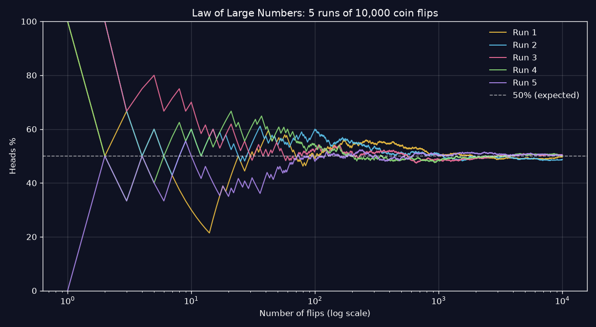

# 🪙 Coin Flip Simulator

An animated coin flip simulator with live statistics and probability charts, built with **Python (Flask)**, **HTML/CSS/JavaScript** and **Chart.js**, plus a **matplotlib** analysis script.

## Features
- **3D coin flip animation**: the coin is tossed, spins and lands on the result chosen by the Python backend
- **Flip many at once**: type how many flips you want (1 to 100,000), or use the 10 / 100 / 1,000 / 10,000 quick buttons, and see that batch's heads/tails split
- **Analyze a range of flips**: choose any stretch (e.g. flips 1–500, or the "Last batch" / "First half" / "Second half" / "All flips" shortcuts) and get its heads/tails split, longest streaks and where they happened, number of runs, a fairness check (z-score), its own heads % graph, and every flip listed for ranges up to 200
- **Live stats**: heads/tails counts and percentages, current streak, best streaks, and a heads-vs-tails ratio bar
- **Flip history**: the last 20 flips shown as chips
- **Probability chart**: running heads % compared with the expected 50%, updated after every flip
- **Law of Large Numbers chart**: `analysis.py` simulates 5 × 10,000 flips and plots how they converge
- Keyboard shortcut (Space), a synthesized flip sound, mobile-friendly layout, and support for reduced motion

## Project structure
```
app.py              Flask server + JSON API
simulator.py        Coin flip logic and statistics (pure Python)
analysis.py         matplotlib convergence chart → static/img/convergence.png
templates/          index.html
static/css, js      Styling and front-end logic
tests/              pytest unit tests
```

## Getting started
Requires Python 3.10+.

```bash
python -m venv .venv
.venv\Scripts\activate          # Windows  (macOS/Linux: source .venv/bin/activate)
pip install -r requirements.txt

python analysis.py              # generate the convergence chart
python app.py                   # start the server
```
Open <http://127.0.0.1:5000> and start flipping.

Run the tests with:
```bash
pytest
```

## API
| Method | Route        | Description                         |
|--------|--------------|-------------------------------------|
| GET    | `/`          | The web app                         |
| POST   | `/api/flip`  | Flip once, or send `{"count": n}` (1–100,000) to flip n times → `{ result, batch, stats }` |
| GET    | `/api/analyze?start=a&end=b` | Analysis of flips a to b (1-based, inclusive) |
| GET    | `/api/stats` | Current statistics                  |
| POST   | `/api/reset` | Clear all statistics                |

## The math
Each flip of a fair coin has probability ½ for heads and ½ for tails, and every flip is **independent**: past results don't affect the next one. With few flips, results can be lopsided and streaks of 4 or 5 in a row are surprisingly common. The **Law of Large Numbers** says the observed proportion of heads approaches 50% as the number of flips grows:



## Ideas for later
- A biased-coin slider
- Saving stats in localStorage or a database
- Deploying to Render or PythonAnywhere
